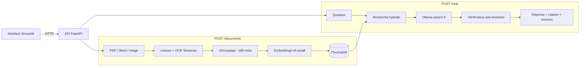

# Enterprise RAG Chatbot

Chatbot qui répond aux questions posées sur **tes propres documents** (PDF, Word, images), en local, sans API payante.
Chaque réponse est accompagnée d'une **citation exacte** et de ses **sources**. Si la réponse n'est pas dans les documents, le chatbot le dit au lieu d'inventer.

## Fonctionnement



- **Ingestion incrémentale** : un fichier déjà indexé (empreinte SHA-256) n'est pas retraité.
- **OCR** : PDF scannés, images (png, jpg) et images incluses dans les PDF.
- **Recherche hybride** : similarité sémantique (embeddings `multilingual-e5-small`) + mots-clés exacts (noms propres, codes, chiffres) + passages voisins.
- **LLM local** : modèle open source via Ollama (`qwen2.5:1.5b` par défaut, changeable).
- **Vérificateur anti-invention** : la réponse est refusée si sa citation n'est pas dans les extraits, si un nom propre est inventé, ou si un chiffre n'est pas dans la citation.

> Pourquoi pas son propre LLM ? Le RAG sert justement à utiliser un modèle déjà entraîné sur des documents qu'il ne connaît pas, sans réentraînement, avec des sources vérifiables. Le travail d'ingénierie porte sur la qualité de la récupération et la fiabilité des réponses.

## Structure

```
backend/app/
  api/         routes FastAPI (/chat, /documents, /health)
  ingestion/   lecture PDF/Word/images, OCR, nettoyage
  chunking/    découpage en passages
  embeddings/  modèle d'embeddings
  vectorstore/ ChromaDB
  retrieval/   recherche hybride
  llm/         client Ollama, prompts
  rag/         pipeline, vérificateur, sélection des preuves
  core/        configuration
backend/tests/ tests pytest
frontend/      interface Streamlit
```

## Installation (sans Docker)

Prérequis : Python 3.10+, [Ollama](https://ollama.com), Tesseract (`sudo apt install tesseract-ocr tesseract-ocr-fra`).

```bash
python -m venv .venv && source .venv/bin/activate
pip install -r requirements.txt
ollama pull qwen2.5:1.5b

uvicorn backend.app.main:app --port 8000          # API  (docs : http://localhost:8000/docs)
streamlit run frontend/streamlit_app.py           # interface : http://localhost:8501
```

## Avec Docker

```bash
docker compose up --build
docker compose exec ollama ollama pull qwen2.5:1.5b   # une seule fois
```

Interface : http://localhost:8501 — API : http://localhost:8000/docs. Les documents et la base sont dans `./data`.

## Ligne de commande

```bash
python -m backend.app.cli sync        # indexe le dossier docs/
python -m backend.app.cli docs        # liste les documents
python -m backend.app.cli ask "Question ?"
python -m backend.app.cli remove fichier.pdf
```

## Configuration

Toute valeur se change par variable d'environnement `RAG_<NOM>` (voir `backend/app/core/config.py`), par exemple :

```bash
RAG_LLM_MODEL=qwen2.5:3b uvicorn backend.app.main:app --port 8000
```

## Tests

```bash
python -m pytest -q     # sans Ollama ni modèle (faux LLM et faux embeddings)
```

## Limites connues

- Un petit modèle (1,5B) se trompe parfois de passage ; le vérificateur préfère refuser que d'inventer. Un modèle plus grand améliore la qualité.
- Les images sans texte ne sont pas décrites (pas de modèle de vision pour l'instant).

## Pistes d'amélioration

Jeu d'évaluation (questions/réponses), reranking, modèle de vision, stockage FAISS alternatif.
